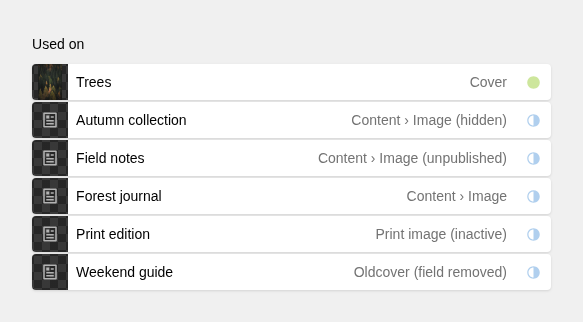

<h1 align="center">Kirby File Usage</h1>
<p align="center">
	See where files are used in Kirby and find unused files
</p>

---



## Get started

```bash
composer require tobimori/kirby-file-usage
```

Read the [documentation](docs/0_file-usage.md) for requirements, settings and detection limits.

## Development

Run setup, then start the playground and Panel HMR in separate terminals:

```bash
bash scripts/setup.sh
pnpm playground
pnpm dev
```

## License

[MIT](LICENSE.md)

Copyright 2026 © Tobias Möritz - Love & Kindness GmbH
