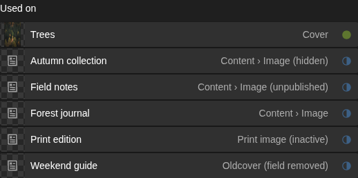
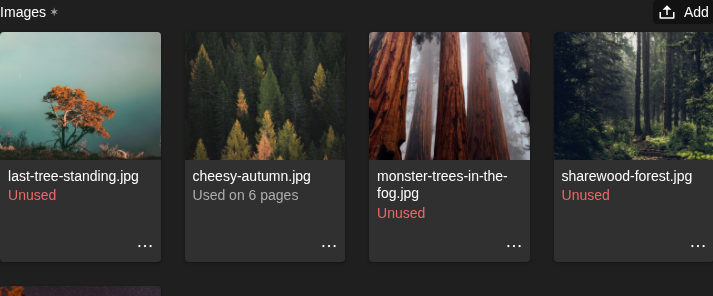
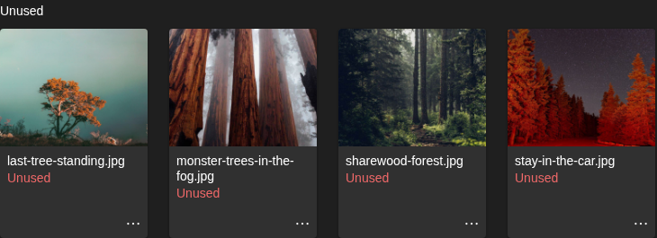
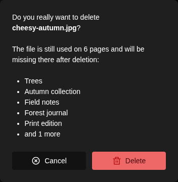

On most Kirby sites, images pile up over time. Some are on five pages, some on none, and nobody knows which is which. Deleting a file is a guess, and a wrong guess leaves a hole on a page you didn't check.

Kirby File Usage finds every page that references a file and shows it right in the Panel.

## Installation

Kirby File Usage requires Kirby 5 and PHP 8.3 or later. In a terminal, go to the folder of your Kirby installation and run:

```bash
composer require tobimori/kirby-file-usage
```

<details>
<summary>Manual installation</summary>

If you don't use Composer, download the latest release from [GitHub](https://github.com/tobimori/kirby-file-usage/releases) and extract it into `site/plugins/kirby-file-usage`.

</details>

The plugin works with the content you already have. Kirby stores a reference to a file with the file's UUID, so the plugin finds existing references right away, including those in drafts and unpublished changes. You don't need to re-save pages or build an index. UUIDs are enabled by default, so unless you turned them off, there's nothing to configure.

The delete warning works as soon as the plugin is installed. For everything else, add a section or a query to your blueprints, as shown below.

## Where is this file used?

Add the `file-usage` section to your file blueprint:

```yaml
# site/blueprints/files/image.yml
sections:
  usage:
    type: file-usage
```

The section lists every page that uses the file, and where on the page: a cover field, an image block inside a gallery, a link in a text. Uses that editors can't see on the website are marked, for example an image in a hidden block or in unpublished changes.



## Usage at a glance

In a files section, you can show the usage as the info text. The label contains HTML, so use `{< >}` instead of `{{ }}`:

```yaml
sections:
  images:
    type: files
    info: "{< file.usageInfo >}"
```

Unused files stand out in red.



## Find unused files

For a cleanup list, filter a files section with `unused`:

```yaml
sections:
  unused:
    type: files
    query: page.files.unused
    create: false
```



## Before you delete

When someone deletes a file that's still in use, the delete dialog lists the pages that will miss it. You don't need to set anything up for this.



Keep in mind that the plugin only sees references in your content. If a template loads files directly, like `$page->images()`, those files still show as unused. Check your templates before you clean up.
